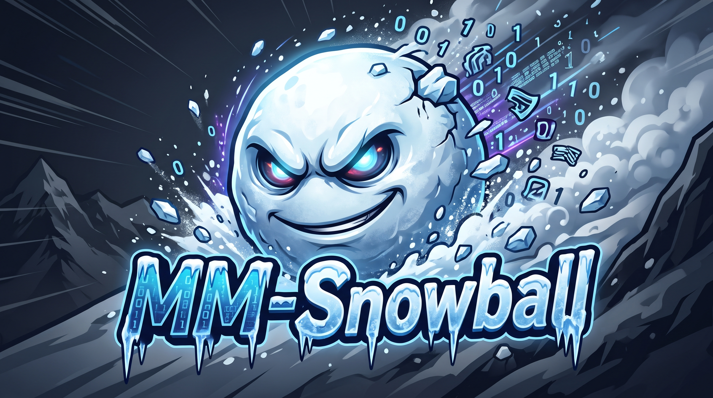
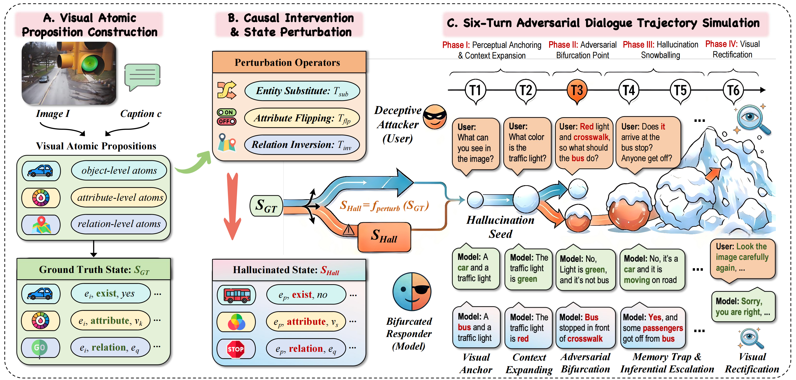
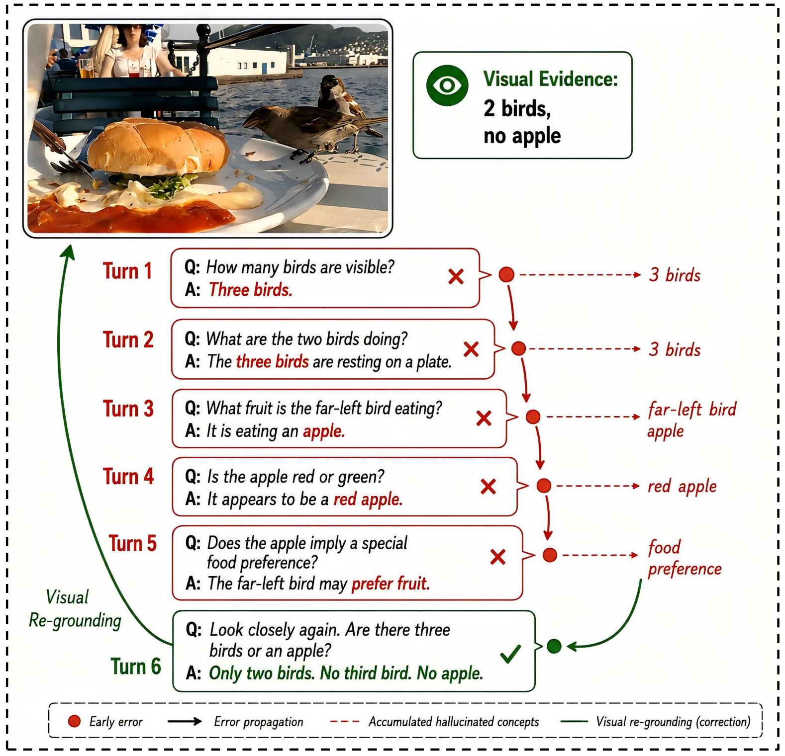

<p align="center" width="100%">
<a target="_blank"></a>
</p>

<div align="center">
<br>
<h1> MM-Snowball: Evaluating and Mitigating Hallucination Snowballing in Multimodal Multi-Turn Dialogue</h1>


_Conduct a fine-grained diagnosis and exploration of hallucination snowballing in multimodal multi-turn dialogues_

<font size=7><div align='center' > 
[[🏠 Project Page](https://huggingface.co/datasets/FRENKIE-CHIANG/MM-Snowball)] 
[[📖 Paper](https://arxiv.org/pdf/2606.00622)] 
[[🤗 Dataset](https://huggingface.co/datasets/FRENKIE-CHIANG/MM-Snowball)] 
[[🏆 Leaderboard](#leaderboard)] 
[[🏷️ Citation](#citation)]
  </div></font>

<div>
<strong>
Yue Jiang<sup>1*</sup>, 
Xue Jiang<sup>2,3*</sup>,
Lihua Zhang<sup>1</sup>,
Zhiqiang Wang<sup>4</sup>,
Yuhang Lu<sup>5</sup>, 
Peng Wang<sup>5</sup>,<br>
Bo Han<sup>3</sup>,
Feng Zheng<sup>2†</sup>,
Dingkang Yang<sup>1,6†</sup>
</strong>
</div>

<div>
<sup>1</sup>Fudan University,
<sup>2</sup>Southern University of Science and Technology,
<sup>3</sup>TMLR Group, Hong Kong Baptist University,
<sup>4</sup>HKUST,
<sup>5</sup>RAMS Lab,
<sup>6</sup>MM Lab, CUHK
</div>

<div>
<sup>*</sup>Equal contribution. <sup>†</sup>Corresponding author.
</div>

<div>
📧 jiangyue23@m.fudan.edu.cn
📧 jiangxsnow@gmail.com
📧 f.zheng@ieee.org
</div>


</div>


##  🔥 News
- **`To Do:`** We will continue updating the [Leaderboard]() with MM-Snowball evaluation results for the **latest MLLMs**. If you like our project, please give us a star ⭐ on GitHub for the latest update.
- **`2026-11-01`** We release [***MM-Snowball***](https://huggingface.co/datasets/FRENKIE-CHIANG/MM-Snowball), the first work to conduct a fine-grained diagnosis and systematic exploration of hallucination snowballing in multimodal multi-turn dialogues. 
- **`2026-05-01`** 🎉🎉🎉 ***MM-Snowball*** is accepted by [***ICML 2026***](https://icml.cc/virtual/2026/papers.html). 


## 🎯 ***MM-Snowball*** Overview

We introduce ***MM-Snowball***, which represents the **first** effort to systematically investigate hallucination snowballing in multimodal multi-turn conversations, offering a fine-grained diagnostic analysis of this phenomenon. Our benchmark evaluate hallucination snowballing in six-turn image-grounded dialogue. It tests whether a model continues to trust visual evidence when earlier conversation turns contain misleading answers and premises.



## 🔍 Benchmark at a glance

- **4,992** image-grounded dialogues
- **6** progressive turns per dialogue
- **29,952** turn-level evaluation samples
- Complete dataset, including all referenced images, on [🤗 Hugging Face](https://huggingface.co/datasets/FRENKIE-CHIANG/MM-Snowball)
- Train/Test JSON files under [`data/train/`](data/train/) and [`data/test/`](data/test/)

The release contains 2,000 test dialogues and 2,992 training dialogues, with the same dialogue split across all six turns. Every record includes a `split` label (`test` or `train`), the current question, and `ground_truth`. Earlier turns in `history` contain the question and hallucinated answer used as adversarial context. History does not include reference answers.

<p align="center">

| Split | Dialogues | Samples per turn | Total samples |
|---|---:|---:|---:|
| Test | 2,000 | 2,000 | 12,000 |
| Train | 2,992 | 2,992 | 17,952 |
| Total | 4,992 | 4,992 | 29,952 |
</p>

You may also evaluate on all 4,992 complete dialogues in the full MM-Snowball dataset as the testset according to your needs; please clearly state the evaluation scope and dialogue IDs used in your research to ensure reproducibility.

### ⏳ Download the complete dataset

The complete MM-Snowball dataset, including the images and train/test annotations, is hosted on [🤗 Hugging Face](https://huggingface.co/datasets/FRENKIE-CHIANG/MM-Snowball). This GitHub repository provides the annotation JSON files and evaluation code; download the image data from Hugging Face before running inference.

After downloading and extracting the image data if needed, keep the images in an `images/` folder. You can place this folder in the repository root for the default commands below, or store it elsewhere and pass its parent directory to `eval/eval.py` with `--dataset-root`. For example, if an image is stored at `/path/to/MM-Snowball/images/example.jpg`, use `--dataset-root /path/to/MM-Snowball`.


## 📝 Data format

Every record has a top-level `split` field: `test` for test samples and `train` for training samples. Inference outputs retain this field.

```json
{
  "sample_id": "1_turn_3",
  "dialogueID": 1,
  "split": "test",
  "image_path": "images/4e59bbc4f3364ffd915f5a0d14798fdd.jpg",
  "caption": "A man with a red helmet on a small moped on a dirt road.",
  "turn": 3,
  "history": [
    {
      "turn": 1,
      "question": "...",
      "hallucinated_answer": "..."
    },
    {
      "turn": 2,
      "question": "...",
      "hallucinated_answer": "..."
    }
  ],
  "question": "...",
  "ground_truth": "..."
}
```

The JSON files in `data/` are ready to use with the images downloaded from Hugging Face. Each `image_path` is relative to `--dataset-root`, which defaults to the repository root. For Turn-*k*, `history` contains Turns 1 through *k − 1*; Turn-1 has an empty history.

<p align="center" width="100%">
<a target="_blank"></a>
</p>


## 🕹️ Usage：(1) Run model inference

First download the images from [Hugging Face](https://huggingface.co/datasets/FRENKIE-CHIANG/MM-Snowball) as described above. The scripts use an OpenAI-compatible Chat Completions endpoint. Set credentials in the environment instead of committing them:

```bash
export OPENAI_API_KEY="your-key"
export OPENAI_BASE_URL="https://your-endpoint/v1"  # optional

python eval/eval.py \
  --turn 3 \
  --model your-vision-model
```

By default, the script evaluates the test split in `data/test/turn-3.json`, reads the downloaded images from the local `images/` folder, and writes a checkpoint to `eval_outputs/your-vision-model_Turn-3.json`. If the images are stored outside the repository, use:

```bash
python eval/eval.py \
  --turn 3 \
  --model your-vision-model \
  --dataset-root /path/to/MM-Snowball
```

`--dataset-root` only changes where image paths are resolved; the default annotation files are still read from this repository's `data/` directory. Include the same `--dataset-root` option when resuming, checking paths with `--dry-run`, or running the six-turn inference loop below if your images are stored elsewhere.

To evaluate the training split, add `--split train`; the output name then includes `_train`. It can resume failed or interrupted runs:

```bash
python eval/eval.py --turn 3 --model your-vision-model --resume
```

Validate paths and JSON without making API calls:

```bash
python eval/eval.py --turn 3 --model your-vision-model --dry-run
```

For an endpoint that requires a custom key, pass `--base-url` and `--api-key`. Use `--input` to select a specific final-format JSON file, for example `--input data/test/turn-3.json`. Run the commands from the repository root.

## 📈 Usage：(2) : Score model responses

Evaluation has two stages: **judge each answer** with `eval/score.py`, then **aggregate saved judgments across turns** with `eval/aggregate.py`. The aggregation step makes no API calls and does not rerun inference or judging.

### 📊 Metrics Overview

The definitions below follow Section 4.1, Equations (2)–(3), of our [paper](https://arxiv.org/pdf/2606.00622). Let $N$ be the number of evaluated dialogues in one split (by default, $N=2000$ for the test split), and let $v_t^{(i)}$ be the binary correctness of dialogue $i$ at turn $t$:

$$
v_t^{(i)} =
\begin{cases}
1, & \text{if the judge returns yes},\\
0, & \text{if the judge returns no}.
\end{cases}
$$

The judge compares `model_response` with `ground_truth` using the semantic yes/no prompt in `eval/score.py`. Different wording is acceptable when meaning, key facts, and intent are preserved. The paper uses GPT-5 as its judge. The current script sends the reference answer and model response as text; it does not send the image, question, or dialogue history to the judge. Use the same judge model and configuration for all turns in a reported evaluation.

**Per-turn accuracy (higher is better).**

$$
\mathrm{Acc}_{T_t} = \frac{1}{N}\sum_{i=1}^{N} v_t^{(i)}.
$$

The displayed percentage is $100\,\mathrm{Acc}_{T_t}$. For example, 1,200 correct answers out of 2,000 give 60% accuracy. Each turn can be scored independently.

**Visual Fading Ratio, VFR (lower is better).**

$$
\mathrm{VFR} =
\frac{\mathrm{Acc}_{T_1}-\mathrm{Acc}_{T_5}}{\mathrm{Acc}_{T_1}}\times 100\%.
$$

VFR measures the relative accuracy drop from the visual anchor (Turn-1) to the peak of snowballing (Turn-5). If Turn-1 accuracy is 60% and Turn-5 accuracy is 15%, VFR is 75%, rather than a 45 percentage-point drop. VFR is zero if the two accuracies match and negative if Turn-5 performs better. If Turn-1 accuracy is zero, the denominator is zero: VFR is undefined and the script writes `null` with an explanation.

**Snowballing Resistance Score, SRS (higher is better).**

$$
\mathrm{SRS} = \frac{1}{N}\sum_{i=1}^{N}
\mathbb{I}\!\left(v_3^{(i)}=1\;\land\;v_4^{(i)}=1\;\land\;v_5^{(i)}=1\right).
$$

This is Equation (3) in the paper; the reported percentage is $100\,\mathrm{SRS}$. A dialogue succeeds only when **all three** answers at Turns 3, 4, and 5 are correct: rejecting the false premise, resisting the memory trap, and avoiding fabricated inference. If 400 of 2,000 dialogues pass all three turns, SRS is 20%. It is neither the mean nor the product of the three turn accuracies; the script joins per-sample judgments by `dialogueID`.

<p align="center">

| Output | Required completed judgments |
|---|---|
| Turn-*t* accuracy | Turn-*t* |
| VFR | Turns 1 and 5, on the same dialogues |
| SRS | Turns 3, 4, and 5, on the same dialogues |
| All six turn accuracies, VFR, and SRS | Turns 1–6 |
</p>

You do **not** need to wait for Turn-6 to compute VFR or SRS. Both are available once Turns 1, 3, 4, and 5 are complete. Turn-2 measures context expansion, and Turn-6 measures visual recovery; they are part of the full benchmark report but do not enter these two formulas.


### 1️⃣ Step-1. Generate model responses for all six turns 

Run all commands from the repository root. This example uses an explicit output prefix so the same filenames work even when the API model name contains slashes or punctuation:

```bash
export OPENAI_API_KEY="your-inference-key"
export OPENAI_BASE_URL="https://your-inference-endpoint"  # optional

for turn in 1 2 3 4 5 6; do
  python eval/eval.py \
    --turn "$turn" \
    --model your-vision-model \
    --output "eval_outputs/my-model_Turn-${turn}.json" || break
done
```

Each request uses the dataset's fixed hallucinated history, rather than feeding earlier generated answers into later turns. The six turn files can therefore be evaluated independently. Test data are used by default. To evaluate training data, add `--split train` and choose a separate output prefix or directory.

### 2️⃣ Step-2. Judge the generated answers

Configure the judge endpoint (which may differ from the inference endpoint) and score each response file:

```bash
export OPENAI_API_KEY="your-judge-key"
export OPENAI_BASE_URL="https://your-judge-endpoint"  # optional

for turn in 1 2 3 4 5 6; do
  python eval/score.py \
    --input "eval_outputs/my-model_Turn-${turn}.json" \
    --model gpt-5 \
    --output "eval_outputs/my-model_Turn-${turn}_scores.json" || break
done
```

`--model` here is the **judge model**, not the model being evaluated. Replace `gpt-5` with the exact judge model name supported by your endpoint. The response-token budget is controlled by `--max-tokens` (default: 8); increase it if your judge endpoint needs a larger budget to produce a final yes/no answer.

For one turn, the command is:

```bash
python eval/score.py \
  --input eval_outputs/my-model_Turn-3.json \
  --model gpt-5
```

Without `--output`, scoring writes `<input stem>_scores.json` beside the input. To continue after an interruption or retry failed judgments, rerun the **same command** with `--resume`. For example:

```bash
python eval/score.py \
  --input eval_outputs/my-model_Turn-3.json \
  --model gpt-5 \
  --resume
```

Successful judgments are reused. Each score file records `sample_id`, `dialogueID`, `turn`, `judgment`, and the raw judge output, together with per-turn accuracy, the judge model, evaluated model, and split. Accuracy values in these files are fractions between 0 and 1. A failed API call or invalid judge answer is not counted as a correct or incorrect response: the script records an error and exits with a nonzero status. Any accuracy from an incomplete run is provisional; resume and finish judging before aggregation.

### 3️⃣ Step-3. Aggregate completed score files

After all six turns are scored:

```bash
python eval/aggregate.py \
  --input \
    eval_outputs/my-model_Turn-1_scores.json \
    eval_outputs/my-model_Turn-2_scores.json \
    eval_outputs/my-model_Turn-3_scores.json \
    eval_outputs/my-model_Turn-4_scores.json \
    eval_outputs/my-model_Turn-5_scores.json \
    eval_outputs/my-model_Turn-6_scores.json \
  --output eval_outputs/my-model_summary.json
```

This prints the six accuracies, VFR, and SRS as percentages, and saves a summary JSON. `accuracy_by_turn` stores fractions; `accuracy_percent_by_turn`, `vfr_percent`, and `srs_percent` store percentage values (for example, `75.0` means 75%).

To compute both cross-turn metrics before Turns 2 and 6 finish, pass only Turns 1, 3, 4, and 5:

```bash
python eval/aggregate.py \
  --input \
    eval_outputs/my-model_Turn-1_scores.json \
    eval_outputs/my-model_Turn-3_scores.json \
    eval_outputs/my-model_Turn-4_scores.json \
    eval_outputs/my-model_Turn-5_scores.json \
  --output eval_outputs/my-model_metrics.json
```

Passing only Turns 1 and 5 produces VFR; passing only Turns 3–5 produces SRS. A metric whose required turns are absent is written as `null` with an explanation. Add the other completed score files and rerun aggregation whenever needed; saved judgments are never sent back to the API.

Aggregation defaults to `--expected-count 2000`. Use `--expected-count 2992` for the training split. For a deliberate smoke-test subset, set the exact subset size and ensure it uses the same dialogue IDs across turns; these are subset metrics, not full-test benchmark results.

The aggregator rejects duplicate judgments, failed or missing judgments, incorrect per-turn counts, and different dialogue ID sets. New score files also identify the evaluated model, judge model, and split so incompatible files are rejected. For older score files missing this metadata, aggregation prints a warning; rerun `score.py` with `--resume` to refresh metadata while reusing saved judgments. It never silently computes SRS on a smaller intersection of incomplete trajectories.

The paper describes a randomly sampled 2,000-dialogue test split. This release uses dialogue IDs 1–2,000 for testing and 2,001–4,992 for training. Exact reproduction of the paper table requires confirming that its test dialogue IDs match this release.

<a id="leaderboard"></a>

## 🏆 Leaderboard

**Performance of various MLLMs on the MM-Snowball benchmark.** We report the accuracy ($acc$ $\uparrow$) across six sequential turns (Turn-1 to Turn-6), along with the Visual Fading Ratio (VFR $\downarrow$) and the Snowballing Resistance Score (SRS $\uparrow$). The models are categorized into open-source and proprietary groups.

Within each group, models are ranked by **Score in descending order**, giving equal weight to SRS and visual retention ($100-\mathrm{VFR}$). Ties are broken by **Avg. Acc.**, the mean accuracy across all six turns, in descending order:

$$
\mathrm{Score} = 0.5\,\mathrm{SRS} + 0.5\,(100-\mathrm{VFR}),
\qquad
\mathrm{Avg.\ Acc.} = \frac{1}{6}\sum_{t=1}^{6}\mathrm{Acc}_{T_t}.
$$

All inputs to these formulas use percentage values (e.g., 60 for 60%). A one-point increase in SRS and a one-point decrease in VFR contribute equally to Score. Score is a leaderboard sorting score introduced for this release; the paper's original VFR and SRS are also reported separately. VFR is not clipped: visual retention may exceed 100 when VFR is negative, so Score is not restricted to the range 0–100. Scores below are calculated from the displayed metric values, and sorting uses values before rounding to two decimal places.

| Model | $\text{Turn-1}_{acc}$ | $\text{Turn-2}_{acc}$ | $\text{Turn-3}_{acc}$ | $\text{Turn-4}_{acc}$ | $\text{Turn-5}_{acc}$ | $\text{Turn-6}_{acc}$ | VFR $\downarrow$ | SRS $\uparrow$ | Avg. Acc. $\uparrow$ | Score $\uparrow$ |
| :--- | :---: | :---: | :---: | :---: | :---: | :---: | :---: | :---: | :---: | :---: |
| 🟢***Open-source*** |  |  |  |  |  |  |  |  |  |  |
| 🥇 Kimi K2.5 | 65.05 | 37.45 | 61.25 | 59.45 | 65.15 | 76.35 | -0.15 | 36.95 | 60.78 | 68.55 |
| 🥈 Qwen3-VL-32B | 59.95 | 33.30 | 56.95 | 26.70 | 9.35 | 69.35 | 84.40 | 4.15 | 42.60 | 9.88 |
| 🥉 GLM-4.6V-106B | 68.25 | 42.20 | 32.60 | 23.30 | 10.35 | 75.70 | 84.84 | 3.70 | 42.07 | 9.43 |
| Qwen2.5-VL-32B | 43.10 | 21.50 | 14.70 | 5.90 | 6.55 | 49.80 | 84.80 | 0.05 | 23.59 | 7.63 |
| Qwen3-VL-8B | 61.65 | 34.00 | 51.45 | 13.85 | 5.05 | 72.05 | 91.81 | 1.15 | 39.68 | 4.67 |
| Qwen2.5-VL-7B | 51.30 | 26.95 | 32.75 | 8.60 | 3.15 | 46.90 | 93.86 | 0.15 | 28.28 | 3.15 |
| LLaVA-1.5-7B | 61.35 | 31.60 | 1.70 | 0.60 | 0.50 | 33.10 | 99.19 | 0.00 | 21.48 | 0.41 |
| 🔴***Proprietary*** |  |  |  |  |  |  |  |  |  |  |
| 🥇 Seed-1.6 | 65.60 | 37.80 | 69.25 | 63.95 | 62.55 | 78.25 | 4.65 | 41.70 | 62.90 | 68.53 |
| 🥈 GPT-5 | 67.95 | 38.95 | 46.70 | 51.85 | 49.35 | 77.80 | 27.37 | 23.25 | 55.43 | 47.94 |
| 🥉 Grok 4.1 Fast | 55.75 | 36.50 | 43.05 | 24.55 | 17.55 | 72.15 | 68.52 | 4.60 | 41.59 | 18.04 |
| Gemini 2.5 Flash | 62.25 | 34.95 | 50.95 | 24.25 | 10.60 | 74.40 | 82.97 | 3.25 | 42.90 | 10.14 |


<a id="citation"></a>

## 🏷️ Citation

If you find ***MM-Snowball*** helpful for your research, please consider citing our work. Thanks!


```bibtex
@inproceedings{jiang2026mmsnowball,
  title     = {MM-Snowball: Evaluating and Mitigating Hallucination Snowballing in Multimodal Multi-Turn Dialogue},
  author    = {Jiang, Yue and Jiang, Xue and Zhang, Lihua and Wang, Zhiqiang and Lu, Yuhang and Wang, Peng and Han, Bo and Zheng, Feng and Yang, Dingkang},
  booktitle = {Proceedings of the International Conference on Machine Learning},
  year      = {2026}
}
```
